<a href="https://www.upwork.com/freelancers/rajasheryar"></a>

  
  
  
  

## 👋 About me

I'm **Raja**, a web developer and Figma designer with **10+ years** of experience and **926 completed jobs** on Upwork. I design in Figma, or take your Figma file, and turn it into a fast, pixel-perfect website in **WordPress, Webflow, Framer or Shopify** that is SEO-ready and easy for your team to edit.

I also run **SOFT IT LAND**, a small web agency on Upwork.

## 🏆 Track record on Upwork


## 🛠️ What I build

| Platform | What I build |
|---|---|
| **WordPress** | Custom themes and **custom plugins**, Elementor, Bricks and Breakdance builds, WooCommerce, PageSpeed and Core Web Vitals tuning, schema markup |
| **Webflow** | CMS builds, **custom CMS filters**, custom login and register pages, **Memberstack, Outseta and Stripe** integrations |
| **Framer** | Marketing sites, CMS blogs and **custom components** |
| **Shopify** | Custom themes and store builds, conversion-focused product pages |
| **Figma** | UI/UX design, design systems, Figma to pixel-perfect code |
| **Also** | HubSpot CMS, GoHighLevel, Squarespace, Wix, React and Next.js |


## 🚀 Featured work

Live websites I built. Click any card to open the site.

<table>
<tr><td width="33%" align="center"><a href="https://www.launchnotes.com/">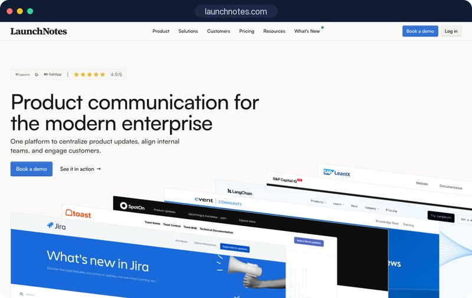</a> <b>LaunchNotes</b> Webflow · SaaS</td><td width="33%" align="center"><a href="https://www.wrightimp.com/">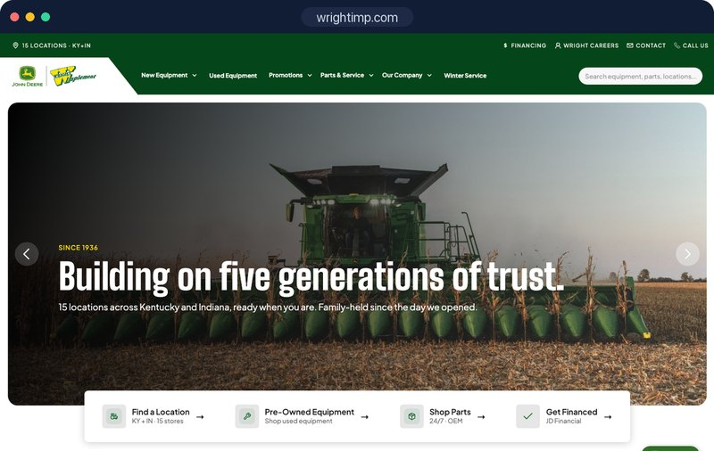</a> <b>Wright Implement</b> Webflow · John Deere dealer, 15 locations</td><td width="33%" align="center"><a href="https://synthiolabs.com/">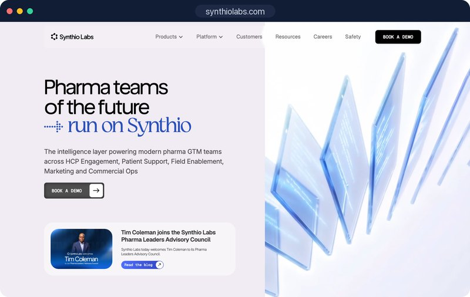</a> <b>Synthio Labs</b> Webflow · AI for pharma</td></tr>
<tr><td width="33%" align="center"><a href="https://geotrekvans.com/">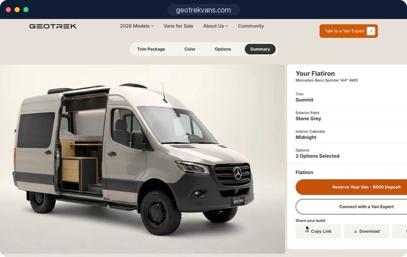</a> <b>Geotrek Vans</b> WordPress · custom van configurator plugin</td><td width="33%" align="center"><a href="https://www.sheffieldhaworth.com/">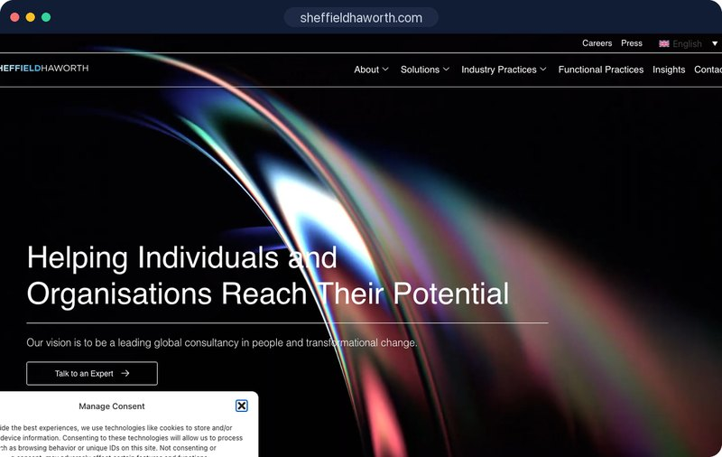</a> <b>Sheffield Haworth</b> WordPress · global executive search</td><td width="33%" align="center"><a href="https://jetts.co.uk/">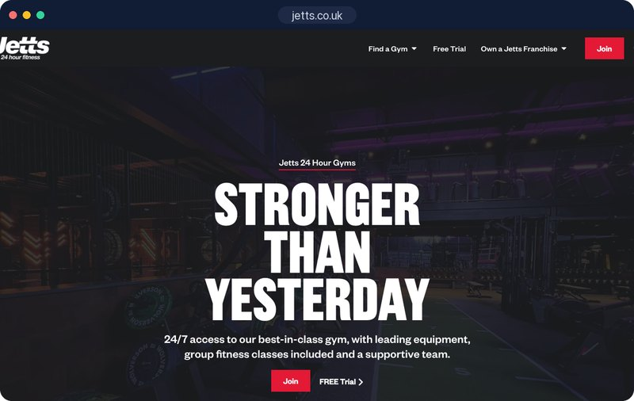</a> <b>Jetts</b> WordPress · 24/7 gym chain</td></tr>
<tr><td width="33%" align="center"><a href="https://www.oipolloi.com/">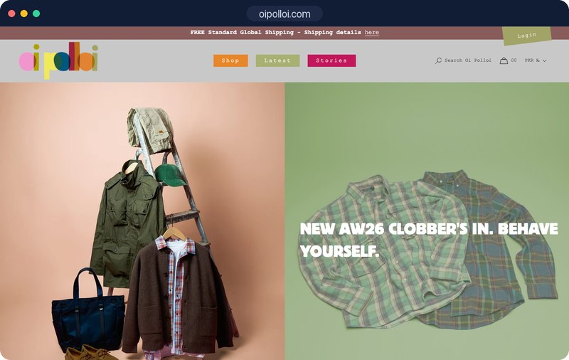</a> <b>Oi Polloi</b> Shopify · menswear retailer</td><td width="33%" align="center"><a href="https://www.tluxe.com/">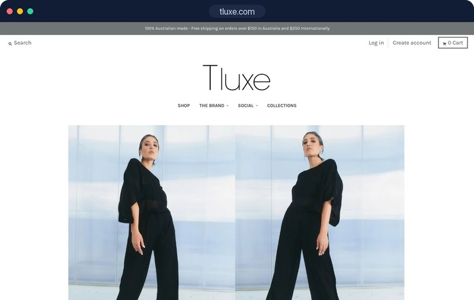</a> <b>T-Luxe</b> Shopify · luxury fashion</td><td width="33%" align="center"><a href="https://drinksorted.com.au/">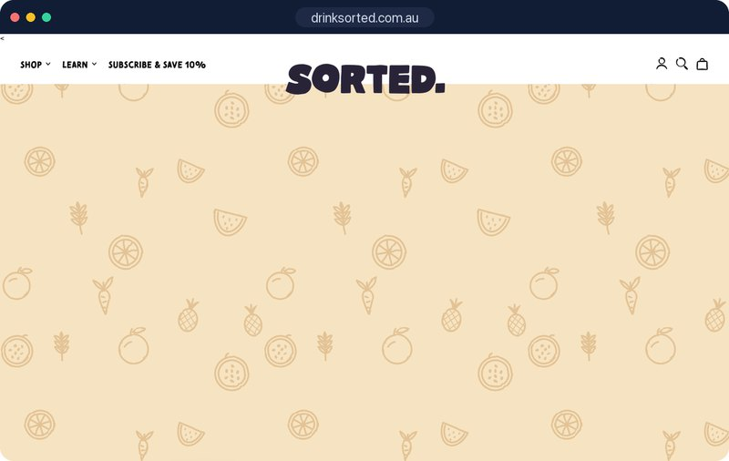</a> <b>Sorted</b> Shopify · gut-health drinks</td></tr>
<tr><td width="33%" align="center"><a href="https://www.metrica-sports.com/">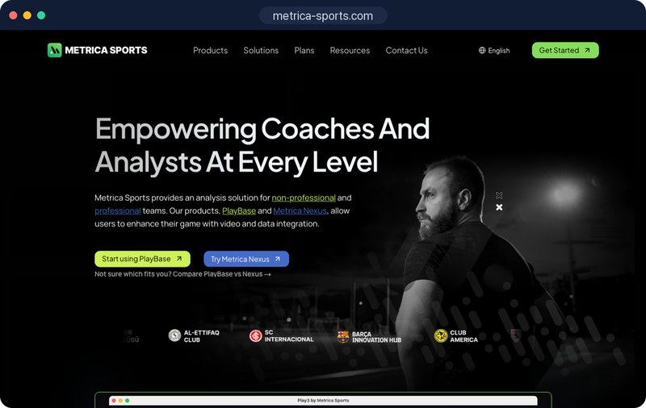</a> <b>Metrica Sports</b> Framer · sports video analysis</td><td width="33%" align="center"><a href="https://www.pathwright.com/">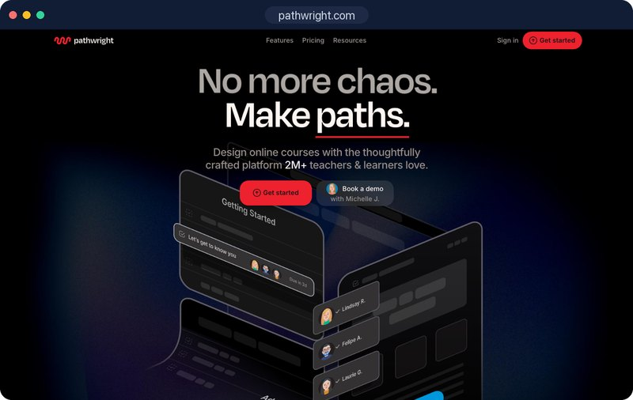</a> <b>Pathwright</b> Framer · SaaS / LMS</td><td width="33%" align="center"><a href="https://www.latitudehealth.com/">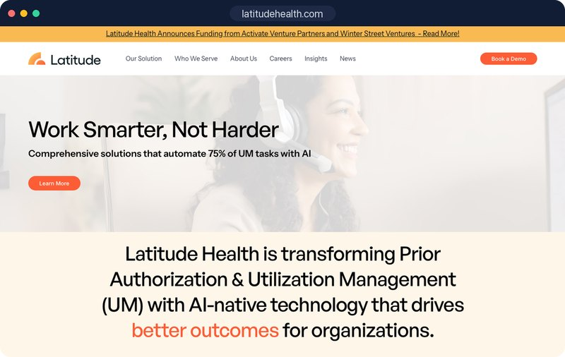</a> <b>Latitude Health</b> Framer · healthcare AI</td></tr>
</table>

More case studies, reviews and 120+ portfolio items are on my <a href="https://www.upwork.com/freelancers/rajasheryar">Upwork profile</a>.

## ⚙️ How I work

1. **Discovery.** We agree on goals, pages, features and the timeline up front.
2. **Design.** UI/UX in Figma, or I build from your own design.
3. **Build.** Pixel-perfect, responsive and easy to edit.
4. **Optimize.** Speed, on-page SEO and cross-browser QA.
5. **Launch and support.** Go-live, hand-over and ongoing help.

<h2 align="center">Let's build your next website</h2>

Invite me to your job or book a consultation on Upwork. I usually reply within an hour.

